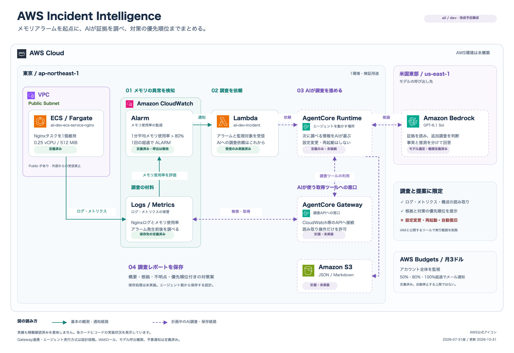

# AWS Incident Intelligence

ECSタスクの異常停止を検知し、生成AIによる調査レポートを残す検証用プロジェクト。

**現在はネットワーク・ECSクラスター・Nginx用ロググループ・タスク実行用IAMロール・正常系タスク定義・タスク用Security Group・停止検知用EventBridgeルール・Lambda実行用IAMロールとログ送信権限・Lambda用ロググループ・受信確認用Lambda本体のTerraform定義とPython処理まで作成済み。ECSログの読み取り権限・Bedrock連携・S3と、EventBridgeのターゲットは未実装。タスク起動手順と異常系の検証設定は未整備。AWSへの構築は未実施。** 設計と手順は、まずこのREADMEに集約する。

## 最初の完成条件

Nginxの設定を意図的に間違えてECSタスクを異常停止させ、停止情報とログをBedrockで分析し、JSON・MarkdownのレポートをS3に保存できること。

## 構成と役割



[draw.ioで編集するファイル](docs/architecture.drawio)をダウンロードし、draw.ioで開けます。図は完成予定の全体構成です。

アイコンは[AWS公式配布ページ](https://aws.amazon.com/architecture/icons/)で2026年10月29日に確認した現行版（2026年7月31日版）を使用しています。

| サービス・道具 | 担当 |
| --- | --- |
| ECS Fargate | 検証対象のNginxコンテナを実行する |
| EventBridge | タスク停止イベントを受け取り、Lambdaを起動する |
| CloudWatch | ログを保管する。取得可能なメトリクスも調査材料にする |
| Lambda | 停止の分類、証拠収集、Bedrockへの依頼、結果の保存を行う |
| Bedrock | 渡された証拠から原因候補と対応方法を生成する |
| S3 | 障害ごとのレポートをファイルとして残す |
| Terraform | 上記のAWSリソースをコードで作成・削除する |

分析処理はECS上で動かさず、Lambdaに分離する。最初はDynamoDBやAIエージェントを追加しない。

## 正常停止と異常停止

EventBridgeは停止を検知し、Lambdaが停止理由・終了コード・タスクの用途を組み合わせて分類する。

EventBridgeルールはデフォルトイベントバス上で、`source = aws.ecs`・`detail-type = ECS Task State Change`・`detail.lastStatus = STOPPED`に一致し、`detail.clusterArn`が対象クラスターARNのイベントを拾う。ECS側の`cluster_arn`出力をincident側の`ecs_cluster_arn`入力変数へ渡す。現段階はルールのみで、Lambdaへの送信はターゲットと呼び出し許可を追加してから有効になる。

| ケース | 扱い |
| --- | --- |
| 意図した手動停止・通常のサービス停止 | 異常として分析しない |
| 正常終了する検証タスク | 異常として分析しない |
| Nginxの設定エラーによる異常終了 | Bedrockによる分析の対象 |
| 情報が足りず分類できない停止 | 判定保留として記録する |

終了コードだけで正常・異常や原因を断定しない。同じ停止イベントが再配信される前提で、重複を識別し、再実行時の扱いを実装時に決める。

## 分析に渡す情報とレポート

Lambdaは発生時刻、タスクARN、停止理由、コンテナ終了コード、関連ログを収集する。CPU・メモリは取得可能な場合に添付し、取得できない情報は理由付きで「取得不可」とする。

単発タスクのCPU・メモリ取得には追加の監視設計が必要なため、最初の完成条件には含めない。

- ログの時間範囲・件数・文字数を制限し、認証情報などを除外してからBedrockへ送る。
- ログやイベントは信頼できない入力として扱い、内部の指示文に従わせない。
- BedrockのモデルIDまたは推論プロファイルと、呼び出し先リージョンを設定で変更可能にする。
- レポートは「概要・確認できた事実・原因候補と根拠・追加調査項目・推奨対応」を分ける。
- インシデントID、発生時刻、対象リソース、使用モデル、トークン使用量も記録する。
- ログ取得失敗時は不足を明示する。Bedrock失敗時も、収集済み証拠と失敗理由をLambdaからS3へ残す。

## 検証環境の方針

- dev環境のみ。Terraformは`network`・`ecs`・`incident`の3つに実行ディレクトリ・Stateを分け、最初は子モジュールを作らない。
- 1 AZ・Public Subnet 1つ。ALB・NAT Gatewayは作成しない。
- タスクは検証時だけ起動する。インバウンド通信は禁止する。
- タスク用Security GroupはECS側で管理し、`vpc_id`入力変数で作成先を指定する。受信ルールは作成せず、送信は`0.0.0.0/0`宛てのTCP 443（HTTPS）のみ許可する。
- NginxはLinux / X86_64のFargateタスクで、CPU 0.25 vCPU・メモリ512 MiBとする。公式イメージ`nginx:1.30.6`を指定し、ECSサービスは作成しない。
- Nginxのログは`/aii/dev/ecs/nginx`に保存し、保存期間を3日とする。
- ログストリーム名は`ecs/nginx/<タスクID>`。ログ送信は`non-blocking`・バッファ10 MiBとし、バッファ超過時はログが欠落し得る。
- タスク実行用IAMロールは、Nginx用ロググループ内のログストリーム作成・ログ送信のみを許可する。
- イメージ取得などに必要な通信は、Public IPとInternet Gateway経由で確保する。
- Lambdaは初期構成ではVPCに接続しない。
- Lambda関数名は`aii-dev-incident`。Python 3.14・arm64・メモリ128 MiB・タイムアウト10秒で定義し、実行ログ用グループ`/aws/lambda/aii-dev-incident`（保存期間3日）と実行ロールを接続する。現段階はイベントID・タスクARN・終了コードなどの受信確認のみをログに出す。環境変数などが含まれ得るイベント全体は出力せず、正常・異常の分類もまだ行わない。
- Lambda実行ロールは`aii-dev-incident-lambda-execution`。自身のロググループ内のログストリーム作成・ログ送信のみを許可する。ロググループはTerraformで作成するため、Lambdaにロググループ作成権限は付けない。ECSログの読み取り・Bedrock呼び出し・S3保存は、対象リソースの定義に合わせて権限を追加する。
- IAMは最小権限。S3はパブリックアクセスを禁止し、暗号化する。
- 認証情報・Terraform State・機密値はGitに含めない。

命名は`aii-環境-用途`を基本とする（例：`aii-dev-vpc`）。`aii`はAWS Incident Intelligenceの略称。共通タグは`Project = aii`、`Environment = dev`、`ManagedBy = Terraform`に統一する。S3など名前の一意性が必要なリソースには識別子を追加する。

## Terraformのファイル構成

以下は予定構成。現在は`network/`と`ecs/`の初期設定、ネットワーク・ECSクラスター・ログ・実行権限・正常系タスク定義を作成済み。他のディレクトリ・ファイルは必要になった段階で追加し、構成が固まってからモジュール化を検討する。

```text
environments/dev/
├── network/            # VPC・Subnet・通信経路
│   ├── versions.tf     # バージョン条件・ローカルState設定（作成済み）
│   ├── providers.tf    # AWS Provider・共通タグ（作成済み）
│   ├── .terraform.lock.hcl # Providerの使用バージョン（作成済み）
│   └── network.tf      # VPC・Subnet・Internet Gateway・ルート設定
├── ecs/                # ECSクラスター・ログ・実行権限・正常系タスク定義・Security Group
└── incident/           # 停止検知ルール・Lambda実行ロールとログ送信権限・Lambda用ロググループ・受信確認用Lambdaまで作成済み。EventBridge接続・S3・分析用権限は今後追加
```

各ディレクトリにProvider・バージョン設定を置き、個別にinit・plan・applyする。同じディレクトリの`.tf`ファイルはまとめて読み込まれるが、隣のディレクトリは自動では読み込まれない。CloudWatch LogsとIAMは、利用するECS・Lambda側で管理する。

`incident/lambda/handler.py`がLambdaの処理本体。Archive Providerで`incident/build/incident-lambda.zip`にまとめ、コードのハッシュで変更を検知する。`build/`はGit管理対象外。ZIPはplan時に生成されるため、保存したplanをapplyする際はZIPも保持する。

ネットワーク、検証タスク、障害分析という変更目的で分ける。`incident/`内は`eventbridge.tf`・`lambda.tf`・`s3.tf`などに整理し、分析機能としてまとめて管理する。

Stateは各ディレクトリの`terraform.tfstate`にローカル保存する（例：`environments/dev/network/terraform.tfstate`）。Gitには含めず、AWS構築後は変更・削除に備えて保管する。各ディレクトリの`.terraform.lock.hcl`はGit管理する。

ディレクトリ間で必要なSubnet ID・ARNなどは、作成元のoutputから利用側の入力へ渡す。具体的な受け渡し方法は実装時に決める。作成は依存先から、削除は利用側から行う。Stateを分けるため、全体の実行順序はTerraformが自動調整しない。

全体の構築順は`network` → `ecs` → `incident`、削除順はその逆とする。後からモジュール化する際は、既存Stateを維持し、`moved`ブロックなどでリソースのアドレス変更に対応する。

初期版はNginx公式イメージを利用するため、専用のECRリポジトリは作成しない。

## 進め方

1. この設計を確認する。
2. ECS基盤 → EventBridge → Lambda → Bedrock → S3の順にコードを作成する。
3. Terraformのfmt / validate、Pythonの単体テストでローカル検証する。
4. リソース一覧・概算費用・State管理・削除手順を確認する。
5. 承認後にAWSへ構築し、正常停止・異常停止・重複・ログ取得失敗・Bedrock失敗を検証する。

**各段階の内容を説明し、了承を得てから次に進む。課金・リソース変更を伴うAWS操作は事前確認を必須とする。**

## 初期版の対象外

フロントエンド、独自Web API、メール・Slack通知、自動復旧、GitHub Actions、停止を伴わない応答遅延・HTTPエラーの検知。

## 参考：AWS公式

- [ECSタスク状態変更イベント](https://docs.aws.amazon.com/AmazonECS/latest/developerguide/ecs_task_events.html)
- [LambdaとBedrockでCloudWatchログを分析する実装例](https://aws.amazon.com/blogs/mt/using-generative-ai-to-gain-insights-into-cloudwatch-logs/)（今回と同一構成ではない）
- [Converse API](https://docs.aws.amazon.com/bedrock/latest/userguide/conversation-inference.html)
