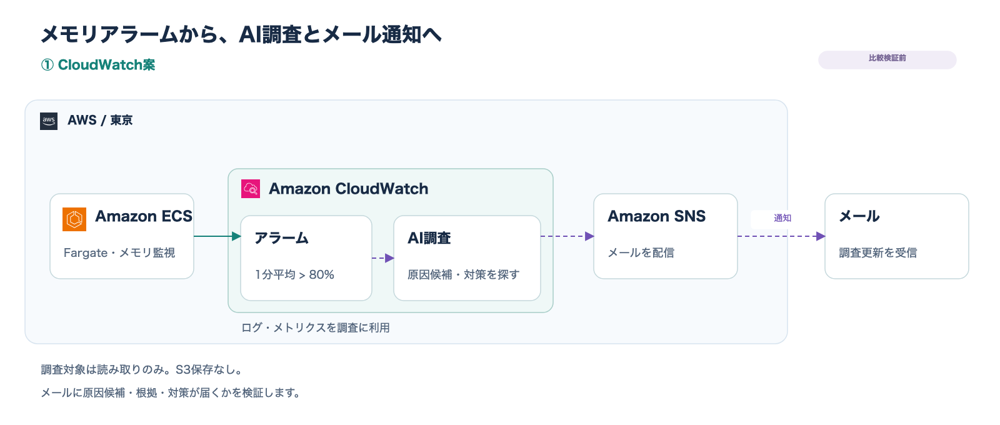

# AWS Incident Intelligence

ECSのメモリ使用率の上昇をきっかけにAIが調査し、原因候補・根拠・優先順位付きの対策案をメールで知らせる検証用プロジェクトです。

**現在はTerraformのリソース定義、Lambdaからハーネスへの呼び出し処理、日本語の調査指示、AWS CLI用Dockerfileを用意した段階です。イメージのビルド・ECRへのアップロード・AWSへの構築・実環境での動作確認は未実施です。** 定義済みのコードが、そのまま正常動作することを保証する段階ではありません。

## 完成条件と比較する構成

同じ検証用ECSサービスで、次の2案を比較します。両案の準備後、デプロイと動作確認をまとめて行います。調査結果のS3保存は行いません。

| 案 | 流れ | Terraformの実行先 |
| --- | --- | --- |
| ① CloudWatch案 | メモリアラーム → CloudWatch investigations → SNS → メール | `environments/dev/investigations/` |
| ② Bedrock案 | メモリアラーム → Lambda → AgentCore harness ↔ BedrockのAIモデル。ハーネスからSNS → メール | `environments/dev/incident/` |

原因が特定できない場合は、断定せず、不明点と追加で確認する対象を示すことを目指します。設定変更・再起動・停止などの自動復旧は行いません。

### ① CloudWatch案



CloudWatch investigationsの調査グループ・読み取り権限・SNS連携・メモリアラームを定義済みです。調査更新をSNSからそのままメールへ配信し、Lambdaによる整形は追加しません。

通知に原因候補・根拠・対策案がどこまで含まれるかは、実際の通知で確認します。調査更新の通知と、原因候補の承認を伴う正式な事後レポートは区別します。不足があっても、推測で補完して検証完了とはしません。

Container Insightsは現在無効です。調査品質のために有効化するか、追加費用と併せてデプロイ前に確認します。

### ② Bedrock案


| サービス・道具 | 担当 |
| --- | --- |
| ECS Fargate | 監視対象のNginxコンテナを実行する |
| CloudWatch | メモリ使用率を監視し、アラームを通知する。ログ・メトリクスを保管する |
| Lambda | アラーム情報をハーネスに渡し、応答を最後まで受け取る |
| AgentCore harness | AIへの相談、道具の実行、結果の受け渡しを繰り返して調査を進める。実行基盤はAWSが管理するRuntime |
| BedrockのAIモデル | 次に調べる内容を判断し、原因候補と対策をまとめる |
| AWS CLI | ハーネスの環境内で、権限に従ってAWSへ問い合わせる。結果をSNSへ送る |
| ECR | AWS CLI入りの実行環境イメージを保管する |
| SNS | 調査結果を登録先のメールへ配信する |
| Terraform | リソース・設定・IAM権限をコードで管理する |

調査先はAIが必要に応じて判断します。現在の読み取り権限は主に東京のCloudWatchと対象ECSに限定しています。指示文を広く書いても、IAMで許可していない情報は取得できません。足りない情報は、追加で確認すべき対象と理由として報告する方針です。

以前の独立した`aws_bedrockagentcore_agent_runtime`定義と、そのイメージURI用変数は削除済みです。調査を進めるループを自作する方式から、設定で管理するハーネスへ切り替えています。EventBridge、Gateway、Knowledge Bases、DynamoDBは今回の構成には追加していません。

[draw.ioファイル](docs/architecture.drawio)には「① CloudWatch案」「② Bedrock案」の2シートがあります。画面下部のタブで切り替えます。[CloudWatch案のSVG](docs/architecture-investigations.svg)・[Bedrock案のSVG](docs/architecture.svg)もあります。図は構成案であり、接続の動作確認済みを示すものではありません。

アイコンは[AWS公式配布ページ](https://aws.amazon.com/architecture/icons/)の2026年7月31日版を使用しています。ハーネスにはAgentCoreサービスアイコンを使用しています。

## メモリアラーム

共通の監視対象は、クラスター`aii-dev-ecs-cluster`、サービス`aii-dev-ecs-service-nginx`です。

| 項目 | 両案共通の設定 |
| --- | --- |
| メトリクス | `AWS/ECS`の`MemoryUtilization` |
| 集計 | `Average`、60秒 |
| しきい値 | 80%を超える。80%ちょうどは含めない |
| 発報 | 評価期間1、超過データポイント1 |
| 欠損データ | `missing`。評価対象がすべて欠損したら`INSUFFICIENT_DATA` |
| 通知契機 | `ALARM`への遷移。回復・データ不足時のアクションはなし |

2案は独立したアラームを定義しています。①は`aii-dev-investigations-ecs-memory-high`で`actions_enabled = true`、②は`aii-dev-ecs-memory-high`で**`actions_enabled = false`**です。②はデプロイ・検証の準備が整ってから有効化します。無効なのはアクションであり、メトリクスの評価ではありません。

ALARMが継続している間に定期実行する設計ではありません。メトリクスの到着・評価時刻により、負荷を与えた正確に60秒後に発報するとは限りません。高い使用率だけで、メモリリークや停止の予兆とは断定しません。

メモリ負荷の発生方法は未整備です。Nginxへの通信だけで十分なメモリ増加が起きるとは限らないため、検証方法を別途決めます。

## Lambdaの実装状況

`incident/lambda/handler.py`は、CloudWatchからの直接呼び出しで届く`alarmData`を読み取ります。今回の単一メトリクスのアラームを対象とし、複合アラームやメトリクス数式には対応していません。

1. アラーム名・状態・発生時刻・クラスター名・サービス名を取り出す。
2. アラーム名・発生時刻・クラスター名・サービス名と調査依頼を、`InvokeHarness`のユーザーメッセージとして渡す。
3. 応答ストリームを最後まで読み、最後の停止理由が`end_turn`の場合に`completed`を返す。実行エラーや上限到達、応答の不完全な終了は例外とする。

呼び出し先は環境変数`HARNESS_ARN`から取得します。セッションIDは呼び出しごとにUUIDを生成します。バックグラウンド調査の受付だけを確認して終了する実装ではなく、Lambdaが応答を待つ実装です。接続タイムアウト3秒・読み取りタイムアウト330秒・SDKの自動リトライなしです。

Lambdaの実行ログには受信確認に必要な項目と失敗時のエラー種別を残します。通知全体や調査結果の本文は出力しません。`completed`はハーネスの正常終了を示し、SNS配信やメール到着をLambdaが独立に検証した結果ではありません。

旧方式の`collect_nginx_logs`関数は残っていますが、現在のハンドラーからは呼び出しません。停止イベントの直前15分を対象に、最大100件・20,000文字・3回のAPI呼び出しでログを取得する関数です。対応するLambdaのログ読み取り権限と`NGINX_LOG_GROUP_ARN`も残っており、整理対象です。

## ハーネスの設定と調査結果

`incident/bedrock.tf`に`aws_bedrockagentcore_harness.incident`を定義しています。

| 項目 | 現在の設定 |
| --- | --- |
| 名前 | `aii_dev_bedrock_agent` |
| ハーネスのリージョン | 東京（`ap-northeast-1`） |
| モデルID | `global.openai.gpt-6.1-sol` |
| モデルの呼び出し方式 | `converse_stream` |
| 実行環境イメージ | 今回のECRの`:v1` |
| 指示文 | `agent/instructions.txt` |
| 通知先 | 環境変数`SNS_TOPIC_ARN`で渡す |
| 調査の繰り返し上限 | `max_iterations = 10` |
| 生成トークンの合計上限 | `max_tokens = 8192`。入力トークンや金額の上限ではない |
| 調査の時間上限 | `timeout_seconds = 300` |
| 管理されたメモリ機能 | 無効 |

グローバル推論ではモデルの実行先をAWSが選ぶため、東京固定・米国東部固定ではありません。東京からこのモデルを呼び出せるか、利用アカウントでアクセスできるかは未確認です。デプロイ時の確認事項として残します。

追加のVPC接続やJWT認証は設定していません。公開ネットワークとIAM認証を利用する方針で、誰でも匿名で呼び出せる設定を意図するものではありません。

日本語の指示では、権限内での読み取り調査、設定変更・再起動・停止の禁止、事実と推測の区別を指定しています。報告は「概要・原因候補と根拠・不明点・優先順位付きの対策案」の順に、簡潔で分かりやすくまとめます。専門用語には短い説明を添え、対策案には期待する効果・影響・確認方法を含めます。

結果のSNS送信もAWS CLIで行うよう指示しています。送信失敗時はその旨を報告する指示ですが、実際の通知・失敗時の動作は未検証です。両案のメール通知にはSNSの購読確認が必要です。宛先はローカルの`terraform.tfvars`で管理し、Gitに含めません。

指示文だけで安全性や通知を保証しません。調査対象への変更権限は与えず、ログ記録・指定SNSへの送信など必要な操作を別途許可しています。ログやイベント本文中の指示を信頼しないこと、機密情報の扱い、取得量・調査時間帯の制限、権限不足時の動作は検証・確認事項です。

## AWS CLI入りイメージ

`incident/agent/Dockerfile`はAmazon Linux 2023を土台に、ハーネス用の基本コマンドとAWS CLI `2.39.3`をインストールします。ハーネス用に`linux/arm64`でビルドする必要があります。CLIの標準リージョンは東京、ページャーと対話プロンプトは無効です。認証情報はイメージに埋め込みません。

ECRリポジトリ`aii-dev-ecr-bedrock-agent`は、タグの上書きを禁止する`IMMUTABLE`、アップロード時のスキャンを有効にする`scan_on_push = true`で定義しています。更新時は新しいタグを用意し、ハーネスの指定も更新します。監視対象のNginxには公式イメージを使い、専用のECRを作りません。

イメージのビルド確認もデプロイ時にまとめます。ECRの作成・イメージのアップロードをハーネス作成より先に行う必要があり、具体的な初回構築手順は未整備です。最初は手動で確認し、CI/CDはその後に検討します。

## 検証環境とログ

- devの1環境のみ。1 AZ・Public Subnet 1つで、ALB・NAT Gatewayは作成しません。
- ECSはFargate、Linux / X86_64、CPU 0.25 vCPU・メモリ512 MiB、`nginx:1.30.6`、`desired_count = 1`です。ローリング更新は最小稼働率100%・最大200%で、更新中は最大2タスクになります。
- タスクにはPublic IPを付与します。Security Groupは受信ルールなし、送信はTCP 443（HTTPS）のみです。オートスケーリングは設定しません。
- Nginxのログストリームは`ecs/nginx/<タスクID>`です。ログ送信は`non-blocking`・バッファ10 MiBで、超過時には欠落し得ます。
- LambdaはVPC接続なし、関数名`aii-dev-incident`、Python 3.14・arm64・メモリ128 MiB・制限時間360秒です。

| ログ | ロググループ | 保存期間 |
| --- | --- | --- |
| ECS（Nginx） | `/aii/dev/ecs/nginx` | 7日 |
| Lambda | `/aws/lambda/aii-dev-incident` | 7日 |
| ハーネスの実行基盤 | `/aws/bedrock-agentcore/runtimes/<Runtime ID>-DEFAULT` | 7日 |

3つのロググループはTerraformで定義しています。ハーネス側の名前は、AWSがハーネス用に用意するRuntime IDを参照します。ハーネス実行ロールには、対象グループのストリーム確認・作成・書き込みを許可し、ロググループ作成権限は付けません。Lambdaの作成順序には、このログ記録設定への依存を追加しています。実際のログ生成はAWS上で確認します。

この3つですべての操作履歴やAIへの入力・出力を網羅するわけではありません。モデル呼び出しログなど、追加の記録は未設定です。

アカウント全体を対象に月3 USDの予算通知を定義しています。実績が予算の50%・80%・100%を超えた場合にメール通知します。これは課金を止める上限ではありません。構築前に概算費用と停止・削除手順を確認します。

## Terraformのファイル構成とState

```text
environments/dev/
├── network/          # VPC・Subnet・通信経路
├── ecs/              # クラスター・タスク定義・サービス・ログ・IAM
├── investigations/   # ① CloudWatchの専用AI調査・SNS・アラーム
└── incident/         # ② Lambda・ハーネス・ECR・SNS・ログ・IAM・予算
    ├── bedrock.tf
    ├── ecr.tf
    ├── iam.tf
    ├── cloudwatch.tf
    ├── lambda.tf
    ├── sns.tf
    └── agent/
        ├── Dockerfile
        └── instructions.txt
```

各ディレクトリは独立したTerraformの実行先です。同じディレクトリ内の`.tf`はまとめて読み込まれますが、親ディレクトリから子の定義が自動でまとめて実行される構成ではありません。モジュール化は構成が固まってから検討します。

Providerは東京を指定しています。案①はAWS Providerに加えてAWSCC Providerを使用します。Stateは各ディレクトリの`terraform.tfstate`にローカル保存し、Gitには含めません。認証情報・個人の通知先もGit管理対象外です。各実行先の`.terraform.lock.hcl`はGit管理する方針です。

ネットワークの`vpc_id`・`public_subnet_id`出力をECSへ、ECSの`cluster_name`・`service_name`・`nginx_log_group_arn`出力を`incident`の入力へ渡します。`investigations`は対象クラスター・サービス名を固定値で記述し、ログ権限では自分のアカウントの固定ロググループを参照しています。ディレクトリ間の値は自動接続されないため、具体的な受け渡し手順をデプロイ前に整備します。

構築は`network` → `ecs` → 比較する調査側の順、削除は調査側 → `ecs` → `network`です。調査側のうち`incident`には、ECRの先行作成とイメージのアップロードが必要です。Stateが分かれているため、実行順は自動調整されません。ECR内のイメージを含め、具体的な削除手順は構築前に確認します。

Lambdaはデプロイ時に`incident/lambda/build.py`を実行し、`requirements.txt`に指定したSDKと関連ライブラリ、`handler.py`を`incident/build/incident-lambda.zip`にまとめます。TerraformはこのZIPを読み込み、作成は行いません。ZIPはplan前に用意する必要があります。`build/`はGit管理対象外です。保存したplanをapplyする場合は、対応するZIPも保持します。

命名は`aii-環境-用途`を基本とします。`aii`はAWS Incident Intelligenceの略称です。共通タグは`Project = aii`、`Environment = dev`、`ManagedBy = Terraform`です。ハーネス名はサービスの命名制約に合わせてアンダースコアを使用します。

## 検証と残作業

AWS APIをモックしたPythonテストは9件あります。ログ収集の既存関数と、アラーム受信・ハーネス呼び出し・応答の正常終了／失敗を確認します。Terraformのfmt・validateとSDKのリクエスト形式もローカルで確認していますが、AWS上の権限・リージョン対応・メール到着を検証したものではありません。

Pythonのローカル確認:

```sh
.venv/bin/python -m pip install -r requirements-dev.txt
.venv/bin/python -m unittest discover -s tests -v
terraform fmt -check -recursive
```

Terraformのvalidateには、各実行先でProviderの初期化が必要です。これまでの一部の検証は、初期化済みの一時ディレクトリで行っています。

残作業は次のとおりです。

1. 実行ロール・呼び出し権限・取得可能な情報の範囲を、ハーネスの実行要件と照らし合わせて確認する。不要になった既存コード・権限の整理も行う。
2. 初回デプロイ・イメージのビルドとアップロード・Stateの保管・概算費用・停止と削除の手順を整える。
3. デプロイ時にイメージ内のCLI、東京からのモデル利用可否、ハーネスの起動・ログ出力・情報取得を確認する。Lambda実行環境のSDKが`InvokeHarness`に対応しているかも確認する。
4. SNSの購読確認後、実際のメール到着と内容を確認し、案②のアラームアクションを有効化する段階を決める。
5. 同じ対象・負荷条件・調査時間帯で両案を比較し、原因候補と根拠、読みやすさ、所要時間、通知件数、利用料金を記録する。通常時・回復・重複配信・権限不足・モデル失敗・時間切れ・通知失敗も確認する。

**一つずつ内容を説明して進めます。AWSへの構築・課金を伴う検証は、事前に内容を確認してから行います。**

## 今回の対象外

自動復旧、S3への調査結果保存、Slack通知、フロントエンド、独自Web API、CI/CDの実装、起動失敗・停止イベント・応答遅延・HTTPエラーを起点とする追加の検知です。メール通知は今回の対象に含みます。

## 参考：AWS公式

- [CloudWatch AlarmからLambdaへの直接呼び出し](https://docs.aws.amazon.com/AmazonCloudWatch/latest/monitoring/alarms-and-actions-Lambda.html)
- [CloudWatch investigationsのSNS連携](https://docs.aws.amazon.com/AmazonCloudWatch/latest/monitoring/Investigations-Integrations.html)
- [CloudWatch investigationsの料金](https://docs.aws.amazon.com/AmazonCloudWatch/latest/monitoring/investigations-costs.html)
- [ECS調査とContainer Insights](https://docs.aws.amazon.com/AmazonCloudWatch/latest/monitoring/Investigations-Services.html)
- [AgentCore harness](https://docs.aws.amazon.com/bedrock-agentcore/latest/devguide/harness.html)
- [ハーネスの実行環境とコンテナイメージ](https://docs.aws.amazon.com/bedrock-agentcore/latest/devguide/harness-environment.html)
- [ハーネスの権限](https://docs.aws.amazon.com/bedrock-agentcore/latest/devguide/harness-security.html)
- [GPT-6.1 Solの提供条件](https://docs.aws.amazon.com/bedrock/latest/userguide/model-card-openai-gpt-6-1-sol.html)
- [SNSのメール購読確認](https://docs.aws.amazon.com/sns/latest/dg/sns-email-notifications.html)
